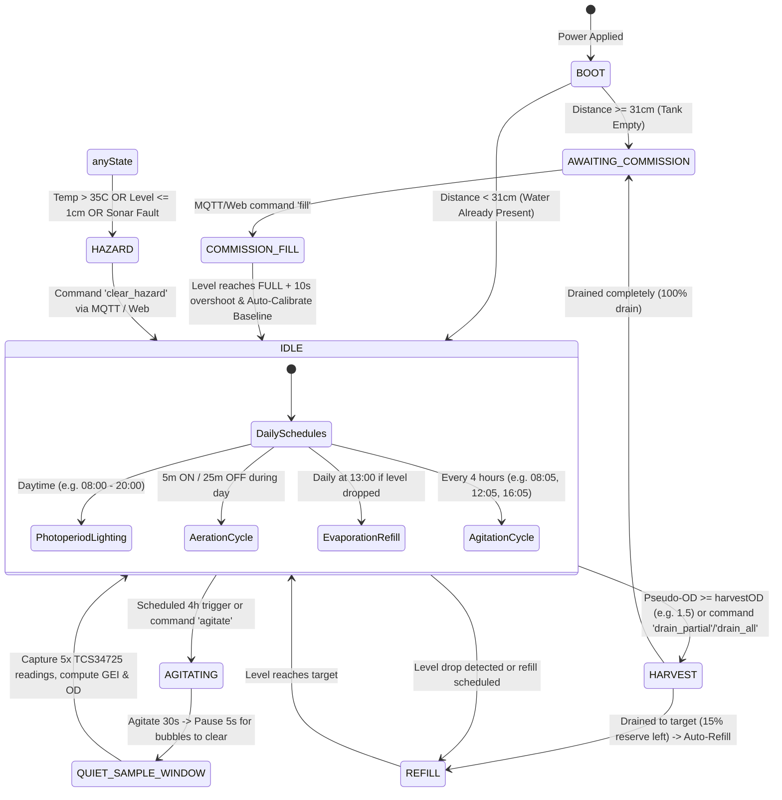

# 🔌 BioArc Hardware: Master Pinout, Wiring & Operational Workflow Reference

> **Document Status:** Active Hardware Reference Log  
> **Target Board:** ESP32 Dev Module (30-pin / 38-pin ESP-WROOM-32)  
> **Power Supply:** 5V DC (Minimum 2.5A recommended for ESP32 + Relays + Sensors) + 12V/24V auxiliary supply for solenoids/pumps

---

## 1. Complete GPIO Pin & Peripheral Mapping Table

| GPIO Pin | Peripheral / Subsystem | Interface | Direction / Type | Operating Voltage | Hardware Logic / Polarity | Notes & Pull-Up Requirements |
| :--- | :--- | :--- | :--- | :--- | :--- | :--- |
| **GPIO 21** | I2C Data (`SDA`) | I2C | Bidirectional | 3.3V | Open-drain | Shared bus: BME280, TCS34725, DS3231 RTC, Dual LCDs. Internal/External $4.7\text{k}\Omega$ pull-up. |
| **GPIO 22** | I2C Clock (`SCL`) | I2C | Output | 3.3V | Open-drain | Shared bus clock line. |
| **GPIO 4** | Submersible Water Temp (`DS18B20`) | OneWire | Bidirectional | 3.3V / 5V | Open-drain | **Requires $4.7\text{k}\Omega$ pull-up resistor** between GPIO 4 and 3.3V/5V rail! |
| **GPIO 18** | Ultrasonic Distance (`JSN-SR04T` / `NewPing`) | Digital | Output (`TRIG`) | 3.3V / 5V | Active-HIGH pulse | Sends $10\mu\text{s}$ trigger pulse to ultrasonic transducer. |
| **GPIO 19** | Ultrasonic Distance (`JSN-SR04T` / `NewPing`) | Digital | Input (`ECHO`) | 3.3V (5V tolerant divider) | Active-HIGH pulse | Measures echo return time. *If using 5V JSN-SR04T, use voltage divider to protect ESP32 3.3V pin!* |
| **GPIO 33** | Media Intake Solenoid Valve (`Relay 1`) | Relay Driver | Output | 5V / 3.3V | Active-LOW (or HIGH*) | Doses fresh nutrient water / media. Controlled by `relays.setIntake()`. |
| **GPIO 32** | Photoperiod Grow Light Array (`Relay 2`) | Relay Driver | Output | 5V / 3.3V | Active-HIGH* (or LOW*) | High-intensity LED lighting for photosynthesis. Controlled by `relays.setLight()`. |
| **GPIO 25** | Aeration Air Sparger Pump (`SSR 1`) | Solid State Relay | Output | 3.3V / 5V | Active-LOW (or HIGH*) | $CO_2$ / air oxygenation bubbling. Controlled by `relays.setAir()`. |
| **GPIO 26** | Outtake Harvest Drain Valve (`Relay 3`) | Relay Driver | Output | 5V / 3.3V | Active-LOW | Drains dense algae culture during harvest. Controlled by `relays.setOuttake()`. |
| **GPIO 27** | Mechanical Agitator Motor / Brush (`Relay 4`)| Relay Driver | Output | 5V / 3.3V | Active-LOW | Cell suspension stirring to prevent biofouling. Controlled by `relays.setAgitator()`. |

---

## 2. Relay Board Configuration & Hardware Polarity (Confirmed)

The physical relay setup on the bioreactor hardware consists of:
1. **2x 2-Channel Relay Modules (Active-LOW)**:
   - Due to a dead channel on one 2-channel module, these currently drive:
     - **GPIO 33 (Intake Solenoid Valve)**: Active-LOW (`LOW` = Valve OPEN / `HIGH` = Valve CLOSED)
     - **GPIO 26 (Outtake Drain Valve)**: Active-LOW (`LOW` = Valve OPEN / `HIGH` = Valve CLOSED)
     - **GPIO 27 (Agitator Motor / Brush)**: Active-LOW (`LOW` = Motor ON / `HIGH` = Motor OFF)
2. **1x Solid State Relay (SSR) (Active-LOW)**:
   - **GPIO 25 (Aeration Air Sparger Pump)**: Active-LOW (`LOW` = Air ON / `HIGH` = Air OFF)
3. **1x Single-Channel Relay Module (Active-HIGH)**:
   - Replaced the dead channel on the original module; physically wired to the high-intensity illumination array:
     - **GPIO 32 (Photoperiod Grow Light Array)**: Active-HIGH (`HIGH` = Lights ON / `LOW` = Lights OFF)

### Software Polarity Mapping
In `RelayManager::setRelay(uint8_t pin, bool turnOn)`:
```cpp
if (pin == 32) {
    digitalWrite(pin, turnOn ? HIGH : LOW); // GPIO 32 is Active-HIGH (Grow Lights)
} else {
    digitalWrite(pin, turnOn ? LOW : HIGH); // All other relays are Active-LOW
}
```
*Note: In the new FreeRTOS architecture, polarity flags are configurable in software per-channel so no hardware rewiring is ever needed if modules are swapped in the future.*

---

## 3. Shared I2C Bus Address Table (GPIO 21 SDA / GPIO 22 SCL)

All 5 devices share the identical two wires:
1. `0x27` (or `0x3F` depending on backpack chip): **Status LCD 1602** (States, IP, Wi-Fi, MQTT status).
2. `0x25` (or solder-jumper modified): **Telemetry LCD 1602** (Water Temp, Air Temp, Humidity, Level, Clock).
3. `0x29`: **Adafruit TCS34725** (RGB & Clear Photodiode for Optical Density / GEI).
4. `0x76` (or `0x77`): **Adafruit BME280** (Temperature, Humidity, Barometric Pressure).
5. `0x68`: **DS3231 RTC Module** (Real-Time Clock with coin battery backup).

---

## 4. Tank Physical Geometry & Liquid Level Calibrations

The non-contact ultrasonic sensor measures the air gap from the top of the tank down to the water surface:
* `DIST_EMPTY = 33 cm`: Sensor reading when tank is empty (water at minimum drain line).
* `DIST_FULL = 8 cm`: Sensor reading when tank is at 100% nominal capacity.
* `DIST_REFILL_TRIG = 4 cm`: Threshold deviation that triggers daily top-off.
* `Overflow Safety Trip`: If distance reads $\le 1\text{ cm}$ (or $\le 2\text{ cm}$), the system trips `STATE_HAZARD` to prevent liquid spillage onto electronics.

---

## 5. Main Biophysical Operational Workflow



### Optical Biomass Calculation Workflow (GEI Model)
1. **Bubbles Settle Window**: When sampling chlorophyll, aeration and agitator are turned OFF for 5–10 seconds to eliminate micro-bubble turbidity.
2. **Grow Light Normalization**: Grow lights are forced ON for 500ms before taking readings to ensure constant optical excitation.
3. **5-Sample Reading**: TCS34725 takes 5 reads and averages them.
4. **Green Excess Index (GEI)**:
   $$\text{GEI} = \frac{G - 0.35(R + B)}{R + G + B + 10^{-6}}$$
5. **Pseudo-Optical Density (Pseudo-OD)**:
   $$\text{Pseudo-OD} = -\log_{10}\left(\frac{C_{\text{current}}}{C_{\text{baseline}}}\right)$$
6. **Chlorophyll-$a$ Estimation**:
   $$\text{Chl-a } (\mu\text{g/L}) = K_{\text{calib}} \times \text{Pseudo-OD}$$

---

## 6. Offline / Recovery Network Access

If Wi-Fi or cloud connection is not active:
* **Access Point SSID**: `BioArc-AP`
* **Access Point Password**: `bioarc_offline`
* **Local Web Dashboard IP**: `http://192.168.4.1` (or `http://bioarc.local`)
* **OTA Firmware Update**: Port 3232 (`espota`)
* **Live Telnet Monitor**: Port 23 (`TelnetStream`)
