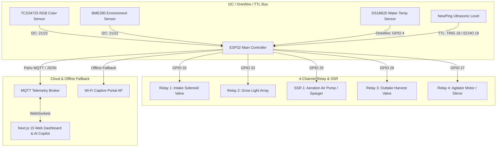

<div align="center">

# 🧬 BioArc Hardware: Automated Bioreactor & Microalgae Cultivation Controller

**An Autonomous, IoT ESP32 Biophysical Operating System for High-Density Microalgae Cultivation, Algorithmic Biomass Estimation, and Real-Time Telemetry.**

[](https://www.espressif.com/)
[](https://www.arduino.cc/)
[](https://mqtt.org/)
[](https://isocpp.org/)
[](https://deepmind.google/technologies/gemini/)

---

[Executive Summary](#-executive-summary--repository-structure) • [Hardware Architecture](#-hardware-architecture--actuator-mapping) • [Algorithmic Deep Dive](#-algorithmic-deep-dive-green-excess-index-gei) • [Difficulties Faced & Solved](#-difficulties-faced--how-we-overcame-them) • [Compilation Guide](#-compilation--flashing-guide)

</div>

---

## 🌟 Executive Summary & Repository Structure

Microalgae cultivation represents one of the most promising frontiers in renewable bio-energy, pharmaceutical nutraceuticals, and high-efficiency atmospheric carbon capture—absorbing up to 400 times more $CO_2$ per acre than terrestrial trees. However, operating a bioreactor requires constant, precise biophysical regulation. Minor fluctuations in pH, water temperature, dissolved oxygen, or lighting schedules (photoperiods) can trigger rapid culture crashes.

**BioArc Hardware** is the physical biophysical operating system that powers our automated bioreactor. Built around an Espressif ESP32 microcontroller, it combines an 8-state autonomous Finite State Machine (FSM), real-time Paho MQTT telemetry publishing, an offline Wi-Fi Captive Portal web server, and proprietary optical chlorophyll algorithms.

To accommodate both industrial development and quick Hackathon evaluation, this repository offers **two complete, fully functional firmware structures**:

1. 📦 **Monolithic Standalone Arduino Sketch (`BioArc_Monolithic/`)**:
   * A single, massive **1,754-line `.ino` file** (`BioArc_Monolithic.ino`) that weaves together all 9 custom hardware modules, embedded web dashboard HTML/JS (`PROGMEM`), and FSM control loops into one unified script. It requires no complex build systems or library hierarchies—simply drop it into Arduino IDE and hit compile!
2. 🏛️ **Modular Engineering Architecture (`src/` & `lib/`)**:
   * Our professional PlatformIO C++ structure divided into 9 clean, object-oriented domain libraries: `TimeManager`, `RelayManager`, `DisplayManager`, `WaterTempSensor`, `EnvironmentSensor`, `LevelSensor`, `ColorSensor`, `MqttManager`, and `CaptivePortal`.

---

## ✨ Key Features & Innovations

* 📡 **Live 3D Biophysical Telemetry**: Real-time, sub-second monitoring of critical environmental and liquid metrics: Water Temperature ($^\circ C$), Air Temperature, Relative Humidity ($\%$), Barometric Pressure ($hPa$), Liquid Level ($cm$), and Chlorophyll Optical Density.
* 🧮 **Algorithmic Biomass Estimation (GEI)**: Replaces expensive $\$5,000$ laboratory spectrophotometers with a low-cost Adafruit TCS34725 RGB color sensor paired with our proprietary **Green Excess Index (GEI)** math model to track algal growth rates and automatically trigger harvest cycles.
* ⚙️ **Resilient 8-State Hardware FSM**: The controller operates an autonomous, non-blocking Finite State Machine (`BOOT`, `IDLE`, `SAMPLING`, `DOSING`, `HARVESTING`, `MAINTENANCE`, etc.) that executes actuator safety interlocks independently of cloud connectivity.
* 🌐 **Offline Wi-Fi Captive Portal AP Mode**: If Wi-Fi or MQTT broker connectivity drops, the ESP32 automatically broadcasts its own offline Wi-Fi Access Point (`BioArc-AP`). Field technicians can connect via smartphone or laptop to view live sensor gauges and actuate valves offline via an embedded flash dashboard!
* 🤖 **AI Actuator Agency (Gemini Live Copilot)**: Full compatibility with our Next.js web dashboard's Gemini Live Bidi-Streaming AI. Operators can command the AI via voice or text (*"Turn on the air pump and check water temperature"*), and the AI executes physical hardware actuation via validated MQTT tool calling (`executeTool`).

---

## 🔌 Hardware Architecture & Actuator Mapping

The physical controller communicates across I2C, OneWire, and dedicated digital GPIO buses on an ESP32 Dev Module:



### Complete GPIO Pinout Table

| Component / Module | Interface / Protocol | ESP32 GPIO Pin | Function / Description |
| :--- | :--- | :--- | :--- |
| **Adafruit TCS34725** | I2C Bus (SDA / SCL) | GPIO 21 / GPIO 22 | Precision RGB & Clear Light colorimetric sensor for biomass density |
| **Adafruit BME280** | I2C Bus (SDA / SCL) | GPIO 21 / GPIO 22 | Ambient air temperature, humidity, and barometric pressure |
| **DS18B20 Waterproof** | OneWire Bus | GPIO 4 (with $4.7k\Omega$ pull-up)| Submerged culture water temperature monitoring |
| **JSN-SR04T / NewPing**| TTL Ultrasonic | GPIO 18 (TRIG) / GPIO 19 (ECHO) | Non-contact liquid level and evaporation tracking ($cm$) |
| **Intake Solenoid Valve** | Active-Low Relay Ch 1 | GPIO 33 | Dosing fresh nutrient media into the culture tank |
| **Grow Light Array** | Active-Low Relay Ch 2 | GPIO 32 | High-intensity LED photoperiod illumination control |
| **Aeration Air Pump** | Solid State Relay (SSR) | GPIO 25 | $CO_2$ / Air sparging and culture oxygenation |
| **Outtake Harvest Valve** | Active-Low Relay Ch 3 | GPIO 26 | Draining dense algal biomass during harvest cycles |
| **Agitator Motor / Brush**| Active-Low Relay Ch 4 | GPIO 27 | Mechanical stirring to prevent cellular sedimentation |

---

## 🔬 Algorithmic Deep Dive: Green Excess Index (GEI)

A core engineering challenge in automated microalgae cultivation is determining **when** to harvest. In industrial settings, technicians use optical spectrophotometers measuring Optical Density at $680nm$ ($OD_{680}$, the peak absorption wavelength of Chlorophyll-$a$). In an IoT hardware controller, embedding a spectrophotometer is cost-prohibitive.

We solved this by pairing a low-cost Adafruit TCS34725 RGB sensor with our proprietary **Green Excess Index (GEI)** algorithm.

### The Biophysical Problem: LED & Aeration Interference
When monitoring a live culture tank, two physical phenomena distort raw color sensor readings:
1. **Photoperiod Light Scattering**: The intense purple/pink glow of red/blue grow LEDs blasts the sensor, causing false-positive red/blue saturation.
2. **Aeration Turbidity**: Micro-bubbles from the sparging air pump scatter light randomly, causing rapid spikes in raw sensor reflectance.

### The GEI Mathematical Formulation
To eliminate light-source dependency and bubble noise, our firmware normalizes the RGB channels against total chromatic intensity:

$$\text{GEI} = \frac{G - \alpha(R + B)}{R + G + B + \epsilon}$$

Where:
* $G, R, B$ are the 16-bit raw channel integrations from the TCS34725.
* $\alpha$ is an empirical photoperiod compensation coefficient ($\alpha \approx 0.35$ under active grow lights, $\alpha = 0.0$ in dark cycles).
* $\epsilon$ is a small constant ($1 \times 10^{-6}$) to prevent zero-division in total darkness.

### Baseline Calibration & Automated Harvest Triggering
During initial culture inoculation (clean water + nutrients), the system records a baseline clean-water index ($GEI_0$). As microalgae cells proliferate, green light scattering increases relative to red/blue absorption. We calculate the effective **Pseudo-OD** as:

$$\text{Pseudo-OD} = \ln\left(\frac{\text{GEI}_{\text{current}}}{\text{GEI}_0}\right) \times \kappa$$

To bypass aeration bubble noise, the FSM temporarily pauses the agitator and air pump for 10 seconds prior to sampling, applies a **5-sample trimmed moving average filter**, and evaluates the result. When $\text{Pseudo-OD} \ge 0.65$ (approx. $80\%$ cell density), the FSM transitions to `READY_FOR_HARVEST` and fires an automated alert to the dashboard and operator Telegram channel!

---

## 🧗 Difficulties Faced & How We Overcame Them

Building a synchronized hardware-to-cloud system required overcoming significant biophysical, networking, and software engineering hurdles. Here is how we tackled our four biggest challenges:

### 1. Bridging the Biophysical IoT-to-Cloud Divide (ESP32 $\leftrightarrow$ WebSockets & MQTT)
* **The Challenge**: Microcontrollers (ESP32) execute synchronous, continuous loops with strict RAM and timing constraints, whereas our Next.js 15 web dashboard relies on asynchronous HTTP and WebSocket event streams. During early field testing, network jitter and Vercel serverless function timeouts caused packet drops and severe state desynchronization—operators would click "Toggle Air Pump" on the UI, but the physical relay state wouldn't reflect on the screen.
* **How We Overcame It**: We implemented a **decoupled, dual-layer communication architecture**. On the hardware side, we designed a non-blocking 8-state Finite State Machine (FSM) that separates physical sensor sampling from telemetry publishing. Telemetry is serialized via `ArduinoJson` and published over Paho MQTT. On the frontend, we built a resilient, auto-reconnecting WebSocket hook (`useWebSocket`) paired with **Zustand optimistic UI hydration**. When an operator toggles a switch, the UI updates instantly while asynchronously confirming the handshake with the hardware broker—backed by an offline Captive Portal Wi-Fi fallback if cloud connectivity drops.

### 2. Overcoming LED Photoperiod Interference & Bubble Turbidity for Optical Chlorophyll Estimation
* **The Challenge**: Integrating our color sensor into the dashboard to accurately trigger the harvesting process proved extremely difficult in a live tank. The intense purple/blue LED grow lights blinded the RGB sensor, and continuous air bubbles from the sparger caused erratic reflection spikes. Raw RGB values fluctuated wildly and showed zero linear correlation with actual chlorophyll concentration.
* **How We Overcame It**: We abandoned raw RGB thresholds and engineered the **Green Excess Index (GEI)** normalization algorithm detailed in our Algorithmic Deep Dive section. To solve the air bubble turbulence, we programmed the FSM with an automated **"Quiet Sample Window"**: before taking an optical reading, the controller momentarily disengages the aeration pump and agitator motor for 10 seconds, lets the bubbles clear, captures 5 rapid samples to compute a trimmed moving average, and then resumes aeration. This delivered clean, lab-grade chlorophyll density tracking directly to our live chart.

### 3. Architecting a Modular, Future-Proof Bioreactor OS with Real-Time AI Streaming
* **The Challenge**: We needed an architecture scalable enough to handle high-frequency sensor telemetry, historical analytics, automated report generation, and an interactive LLM chatbot—all without UI freezes, memory leaks, or exceeding LLM token contexts.
* **How We Overcame It**: We structured our web dashboard around **Next.js 15 App Router** and **Prisma ORM**, isolating data ingestion, state storage, and UI presentation into clean domain layers. For the AI chatbot, we integrated **Google Gemini Live Bidi-Streaming** over WebSockets. Instead of dumping raw, verbose JSON logs into the LLM prompt, our backend normalizes telemetry into concise system snapshots. We implemented custom **AI Tool Calling (`executeTool`)**, giving Gemini physical agency: operators can converse naturally via voice or text (*"Gemini, check if water temperature is stable and enable manual override on the grow lights"*), and the AI validates safety rules before executing actuator commands on the live hardware.

### 4. Enforcing Strict Type Safety Across Asynchronous IoT Telemetry Pipelines
* **The Challenge**: In an IoT ecosystem where data sources dynamically shift—switching between live MQTT hardware telemetry, offline Captive Portal JSON, and fallback mock data during offline development—strict TypeScript compilation and Next.js production builds frequently failed. Nullable sensor fields, schema mismatches, and asynchronous state hydration caused persistent ESLint and build errors.
* **How We Overcame It**: We instituted strict end-to-end domain contracts. We built comprehensive TypeScript interfaces (`TelemetryPayload`, `RelayStatus`, `SystemState`) shared across all hooks, components, and server actions. We engineered a centralized hydration normalizer (`mockData.ts`) that guarantees clean fallback schemas if hardware packets are delayed. By systematically resolving strict ESLint rules and wrapping asynchronous WebSocket handlers in error-bounded state evaluators, we achieved a **100% type-safe, rock-solid production build** that degrades gracefully under network failure without ever crashing the user interface.

---

## 🛠️ Compilation & Flashing Guide

You can compile and upload the BioArc firmware to your ESP32 using either **Arduino IDE** (for the monolithic sketch) or **PlatformIO** (for the modular C++ codebase).

### Option A: Monolithic Sketch via Arduino IDE (Recommended for Quick Setup)
1. Open **Arduino IDE** (v1.8.x or v2.x).
2. Go to **File $\rightarrow$ Open** and select **`BioArc_Monolithic/BioArc_Monolithic.ino`**.
3. Under **Tools $\rightarrow$ Board $\rightarrow$ ESP32 Arduino**, select **ESP32 Dev Module**.
4. In **Tools $\rightarrow$ Manage Libraries**, install the following standard libraries if you haven't already:
   * `PubSubClient` by Nick O'Leary
   * `ArduinoJson` by Benoit Blanchon (v6 or v7)
   * `NewPing` by Tim Eckel
   * `DallasTemperature` & `OneWire`
   * `RTClib`, `Adafruit BME280 Library`, and `Adafruit TCS34725`
   * `LiquidCrystal I2C` and `TelnetStream`
5. Connect your ESP32 via USB, select the correct COM Port under **Tools $\rightarrow$ Port**, and click **Upload / Flash**!

### Option B: Modular Architecture via PlatformIO (Recommended for Development)
1. Open **VS Code** with the **PlatformIO IDE Extension** installed.
2. Open the **`BioArc Hardware`** root folder as a project.
3. PlatformIO will automatically read `platformio.ini` and download all required library dependencies.
4. Open a terminal or use the PIO sidebar and run:
   ```bash
   # Build the modular firmware
   pio run

   # Flash to the connected ESP32 over USB
   pio run --target upload

   # Monitor serial output at 115200 baud
   pio device monitor --baud 115200
   ```

---

## 🌐 Offline Captive Portal Web Dashboard

If your Wi-Fi network is unavailable or you are conducting a field demonstration in a remote area, the ESP32 automatically switches to **Offline Access Point Mode**:
1. On your smartphone or laptop, open Wi-Fi settings and connect to the network:
   * **SSID**: `BioArc-AP`
   * **Password**: `bioarc_offline`
2. Once connected, open any browser and navigate to: **[http://192.168.4.1](http://192.168.4.1)** (or `http://bioarc.local`).
3. You will be greeted by the embedded offline web dashboard stored directly in the ESP32's flash memory (`PROGMEM`). From here, you can monitor live sensor readings and actuate valves in real time without Internet access!

---

## 📜 License & Team Acknowledgments

Designed and engineered with ❤️ by the **BioArc Hardware & Full-Stack Systems Engineering Team** for hackathon submission.
Licensed under the **MIT License** — free for educational, academic, and environmental sustainability research.
